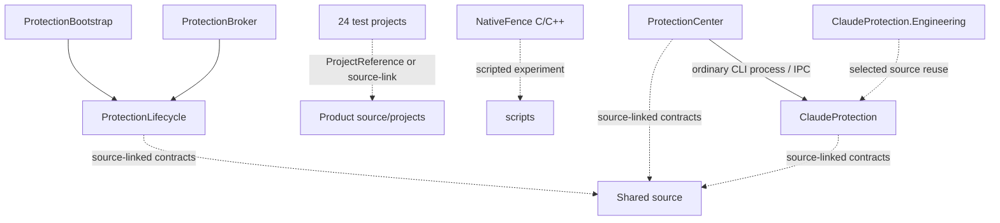
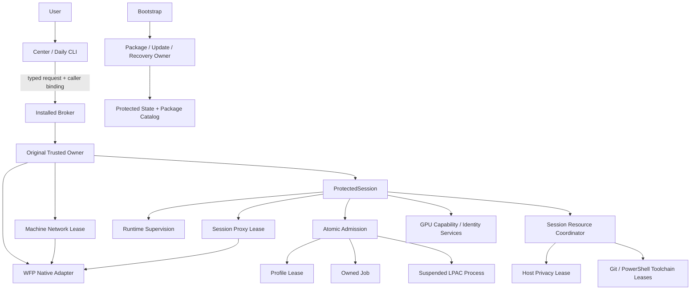

# ClaudeCode-Protection 架构基线与目标架构（2026-11-12）

> 现有产品的模块和资源所有权边界已冻结，基准为 `d7507e57959c8c580a79657b756ec5fc6611b6db`，见第 14 节。前文保留以 `74578e9` 开始的历史审查、阶段目标和中间快照。未来全机网络所有者及其原生执行机制仍为设计。
>
> 本文是架构职责和依赖方向的权威文档。正式安全目标仍由 [SECURITY-REQUIREMENTS](SECURITY-REQUIREMENTS.md) 定义；当前实现和验收事实由 [CURRENT-STATE](CURRENT-STATE.md) 与 [PROJECT-ACCEPTANCE](PROJECT-ACCEPTANCE.md) 定义；机制细节仍由对应专题文档定义。

## 1. 审查范围与基线

已直接检查当前开发分支的 Git HEAD、PR #3、目标分支比较、最新 Actions、完整 Git Tree、五个产品项目的显式编译清单、核心 Lifecycle 源码、24 个测试项目的项目文件、三个 Actions workflow、Bootstrap 资产清单、README、AGENTS、CURRENT-STATE、DOCUMENTATION-INDEX、SECURITY-REQUIREMENTS 和 2026-11-12 静态构建边界审查。

| 项目 | 基线事实 |
|---|---|
| Repository | `simple-sudo/ClaudeCode-Protection`（Public） |
| Branch | `chatgpt/complete-git-workflow-20261110` |
| HEAD | `74578e903c2584628d853598ef8f1910adf7da5b` |
| PR | #3，OPEN / DRAFT，base 为 `codex/integrate-privacy-admission-20261027` |
| Base SHA | `8d56b0c40ef92d384b572bb168eec6bcd8a44d4e` |
| Branch relation | ahead 237 / behind 0 |
| Latest observed Actions | 43190088230、43190088178、43190088173，均 SUCCESS |
| Product projects | 5 |
| Test projects | 24 |
| src tree | 193 entries（含目录项） |
| scripts | 16 entries |
| GitHub workflows | 3 |

Actions 的成功范围只包括其实际执行的托管编译、托管策略/契约测试、Runner Git 和限定 NTFS fixture。它不证明产品 Broker、真实 Owned Job、真实 LPAC token、完整产品创建链、真实 Claude 或全机网络保护通过。

## 2. 当前完整工程结构

```text
/
├─ .github/workflows/
│  ├─ hosted-compile.yml
│  ├─ policy-smoke.yml
│  └─ workspace-git-workflow.yml
├─ docs/                         # 现行规范、机制专题、状态、验收与历史证据
├─ samples/                      # 固定样例与受控项目数据
├─ scripts/                      # 构建门禁、环境审计、实验和恢复脚本（16 项）
├─ src/
│  ├─ ClaudeProtection/           # 日常 CLI
│  ├─ ClaudeProtection.Engineering/ # 工程/实验入口
│  ├─ ProtectionCenter/           # WPF UI
│  ├─ ProtectionBroker/           # 可信管理入口
│  ├─ ProtectionBootstrap/        # 安装、更新、恢复入口
│  ├─ ProtectionLifecycle/        # 当前核心管理程序集
│  ├─ Shared/                     # 源码级共享契约与纯逻辑
│  └─ NativeFence/                # 原生 C/C++ WFP/网络实验
└─ tests/                         # 24 个 C# 项目及 PowerShell/原生测试
```

### 2.1 产品项目和程序集依赖

| 项目 | 输出 | 当前依赖与边界 |
|---|---|---|
| ClaudeProtection | `ClaudeProtection.exe/.dll` | 日常用户 CLI；显式编译自己的日常源码，并链接部分 Shared 源码；不引用 Lifecycle |
| ClaudeProtection.Engineering | 独立工程输出，AssemblyName 保持 `ClaudeProtection` | 单独显式编译实验代码；复用 CLI 源文件；不引用日常产品项目或 Lifecycle |
| ProtectionCenter | WPF EXE/DLL | UI、BackendClient、项目交互；链接 Shared 源码；通过已安装 CLI/受限 Broker 通道工作 |
| ProtectionBroker | EXE | 仅 Program 入口 + ProjectReference 到 ProtectionLifecycle |
| ProtectionBootstrap | EXE | 仅 Program 入口 + ProjectReference 到 ProtectionLifecycle；嵌入批准清单与 transition |
| ProtectionLifecycle | DLL | 当前 Broker 和 Bootstrap 共用的单体管理程序集；显式编译生命周期、原生适配、网络、GPU、隐私、工具链、恢复和 Shared 源码 |

当前项目引用图：



实线表示项目引用或运行时调用关系；虚线表示源码链接、测试复用或脚本实验，不表示独立程序集依赖。Center 与 CLI 的进程边界、CLI 与 Broker 的受限 IPC、Bootstrap 的独立受审入口必须继续保持。

### 2.2 测试项目完整清单

`tests/` 下当前有 24 个 C# 项目：

- AfdCreateTrace、AfdDispatchBoundary、AfdTraceAnalysis
- CenterResults、DeviceBoundary、DirectoryNames、EtwProviderQuery、FailedProjectInspection
- GatewayCapabilityBoundary、GpuCallProgress、GpuHostReference、LpacBoundary、ManifestReadAccess
- NetworkContent、OwnedToolLaunch、OwnerTokenAudit、PolicySmoke、ProfileRecovery
- ProtectedLifecycle、TaskWorkspaceNative、TokenCapabilities、WfpReadStatus
- WorkspacePipe、WorkspaceTransfer

另有 Static-LifecycleContract、Static-Protocol、Static-RecoveryContract、Static-RemovalContract、Static-SourceTypesReference 等 PowerShell 静态测试，以及 SessionZeroStartupWitness C 源码/脚本。测试既有 ProjectReference 到 Lifecycle 的集成 harness，也有直接链接生产源文件的 source-linked harness，还有独立 Windows 原生实验；测试程序集不得进入日常 CLI 或正式安装资产。

### 2.3 CI 分层

| Workflow | 当前责任 | 不能证明 |
|---|---|---|
| hosted-compile.yml | 静态构建边界检查；五个产品项目编译，不运行产品 | 产品运行、安装、真实 Token/Job/LPAC |
| policy-smoke.yml | 纯策略/契约与日常 CLI 的限定 smoke | Windows 强制边界、产品 Broker 端到端 |
| workspace-git-workflow.yml | 五个产品编译；六个聚焦 harness 编译；普通用户策略/Runner Git 与 elevated NTFS fixtures | 产品 Broker 创建的 LPAC、真实产品 Git 资产、Claude、全机网络 |

## 3. 当前架构事实与问题清单

严重程度：P0 = 可能影响安全授权/资源所有权；P1 = 明显耦合、难以独立验证或演进；P2 = 工程维护成本。

| ID | 严重度 | 当前事实 | 架构影响 |
|---|---|---|---|
| A-01 | P1 | ProtectionLifecycle.csproj 将生命周期、安装恢复、WFP、Session 0、LPAC、网络、GPU、隐私和工具链约 80 行显式编译清单集中进单一程序集 | 变更影响面过大；无法按领域独立测试/演进；Broker 与 Bootstrap 被迫共同携带整个管理实现 |
| A-02 | P1 | AtomicAdmission.cs 约 1,442 行，包含 Profile lease、Job completion/receipt、Token/成员检查、Suspended process 创建/恢复等多个类型和职责 | 资源所有权虽有显式对象，但文件边界掩盖了 Profile、Job、Process、Token 四种不同责任 |
| A-03 | P1 | ProtectedSession.cs 约 1,001 行，同时包含固定操作模式、会话编排、环境资格、Fence、Proxy/Gateway、资源、运行租约、反馈及关闭流程 | 策略选择、生命周期编排、网络适配和工作区工作流耦合 |
| A-04 | P1 | SessionResources.cs 约 674 行，同时持有目录/文件/工具/工作区/Git/隐私探针资源，并负责准备与清理 | 聚合资源所有者与具体领域实现耦合，失败释放顺序不易局部验证 |
| A-05 | P1 | InstalledBroker.cs 约 551 行、BootstrapInstaller.cs 约 789 行；Broker 命令门、数据流、恢复与安装/更新/恢复编排在同一管理程序集内 | 可信入口与领域实现的边界不够清晰；安装与运行时生命周期不应共享不必要的内部权限面 |
| A-06 | P1 | SessionGitToolchain.cs 约 632 行；资产校验、持有、命令计划、执行、协议检查和回执验证集中 | Git 资产供应链、受限执行和结果核验无法独立演进 |
| A-07 | P1 | HostPrivacyProbe.cs 将宿主基线采集、目标计划、受限探针执行、封存、闭合和报告放在同一实现内 | 可信采集端、受限读取端、证据验证端边界需显式化 |
| A-08 | P1 | SessionProxy 与 NetworkQualification 位于同一 Lifecycle 程序集；当前 SessionProxy 是固定会话资格通道，不是全机代理 | 必须明确 Session 网络边界与独立 Machine Network Protection 生命周期，不能误把现有会话代理升级为全机能力 |
| A-09 | P1 | GPU 计算、Session 0 启动/辅助路径、宿主参考和设备身份观察均编译在 Lifecycle | GPU 能力保持与硬件身份保护应分开决策、分开证据、共享必要的低层句柄适配 |
| A-10 | P1 | SessionZeroCreator、SessionZeroWindow、OfflineConsole、OpenSSL/Schannel 资格实验大量共处 Lifecycle | Session 0 服务/创建者与会话内策略、TLS/诊断实验存在领域混杂 |
| A-11 | P1 | Shared 不是独立项目；多个产品和测试显式链接同一源码 | 源码重复编译是当前部署布局选择；契约必须保持序列化兼容，不能无审查地跨程序集传递对象引用 |
| A-12 | P1 | tests 中同时存在 Lifecycle ProjectReference、生产源码链接、原生独立实验 | 测试可信度与覆盖范围必须逐项标注，不能把 source-linked fake owner 测试等同产品集成 |
| A-13 | P1 | ProtectedLifecycleCoordinator 只由 tests/ProtectedLifecycle 编译，不在产品 Lifecycle.csproj 中；其 RestoreIpv6 状态仍是旧模型 | 它不是当前第二个运行时 Owner，但属于未与 ProtectedSession 生产编排统一的测试状态模型；不得直接晋升为第二授权中心 |
| A-14 | P1 | PackageAssetCatalog 与 Bootstrap 内嵌 ApprovedPackage/InactiveUpdateTransition 有版本和资产集耦合；当前代码清单 schema 32，而嵌入批准文件仍是 schema 6 / 24 项 | 新 DLL、移动资产或修改输出布局会改变包资产哈希、Release、Manifest 和恢复兼容性 |
| A-15 | P2 | 多项目显式 Compile Include 和测试 source-link 依赖文件路径 | 重命名/拆文件时容易漏改编译清单、测试和 workflow path filter |
| A-16 | P2 | 历史文档多、权威文档索引已建立，但架构职责仍主要分散在专题和历史记录 | 需要一个唯一架构基线并把状态、需求、机制、历史分层引用 |

### 3.1 尚未证实的问题（不得写成缺陷）

- 没有从当前项目引用图发现产品项目之间的 ProjectReference 循环；这不排除源码级调用耦合或逻辑环。
- 当前未证明存在两个同时运行的生产安全授权中心。ProtectedLifecycleCoordinator 是测试专用模型，不在产品编译清单；ProtectedSession 是当前实际编排主体。
- 不能仅凭同一程序集认定模块共享了同一资源所有权；必须继续检查具体字段、构造函数、Dispose、receipt 与调用链。
- 当前全机网络模式是 REQUIREMENT_ONLY / DESIGN；SessionProxy、PersistentFence、NetworkQualification 的现有实现范围不能作为全机公网代理证据。

## 4. 目标架构原则

1. 保留原可信 Broker/Owner 作为唯一安全授权中心。领域模块可以提出资格/策略结果，但不能自行签发高权限许可。
2. Broker 只接受固定、类型化、版本绑定的命令；不增加任意提权 Shell、通用执行器或第二管理权限体系。
3. AtomicAdmission 仍在首指令前完成精确进程创建、LPAC Token 核验和 Job 预绑定；不得启动后补挂 Job。
4. 现有 Profile、Job、Process/Thread、WFP、Proxy、Workspace、Tool、HostPrivacy 等资源分别只有一个明确 owner；其他模块持有只读观察或受限借用 lease。
5. Claude Session 生命周期与 Machine Network Protection 生命周期独立。关闭 Claude 不得释放仍活动的全机网络 lease。
6. 全机公网 IPv4/IPv6 必须通过指定美国住宅代理；不支持的协议阻断，DIRECT 回退禁止。现有会话代理不是全机实现。
7. P0-HOST 与 P0-NET 独立验收；网络代理不能替代宿主隐私保护，宿主探测不能替代 WFP 强制边界。
8. GPU 计算能力与 GPU 硬件身份观察/隔离是两个独立能力；保留正常 CUDA 计算。
9. 产品运行时自评/画像为确定性本地规则，不让 LLM 决定准入或自动上传原始证据。
10. 不一次性重写、不为形式创建大量 DLL。先提取文件内职责并固定契约，再根据部署/权限隔离的真实需要决定程序集边界。

## 5. 目标模块结构与责任矩阵

目标首先是逻辑模块/namespace 和内部文件边界；不预设每个模块都成为独立 DLL。

| 目标域 | 主要职责 | 唯一资源/决策所有者 | 允许调用 |
|---|---|---|---|
| User Experience | UI、普通 CLI、展示、用户输入校验 | Center / Daily CLI，各自只拥有 UI 状态 | 类型化客户端、Shared DTO |
| Broker Boundary | 固定命令解析、调用者/版本/请求验证、授权路由 | InstalledBroker / 原可信 Owner | Lifecycle orchestrator、领域 service |
| Bootstrap & Recovery | 包批准、安装、更新、恢复、卸载事务 | BootstrapInstaller / 对应恢复 owner | Package catalog、ProtectedState、固定恢复服务 |
| Session Admission | 会话意图、一次性准入、原子创建序列 | ProtectedSession 的原 owner | Admission policy、AtomicAdmission、Job/Token adapters |
| Process Isolation | LPAC、Token、Suspended Process/Thread、Job 预绑定与核验 | AtomicChild / OwnedKernelJob / ProfileLease 各自持有其原生对象 | Native Windows adapters、admission owner |
| Session Lifecycle | 会话状态、资源准备/监督/关闭 | ProtectedSession | Runtime lease、资源 owner、session network owner |
| Machine Network | 全机 WFP 出口屏障、代理身份/端点绑定、DNS/路由、Watchdog、恢复 | 独立 MachineNetworkLease；授权仍来自原 Broker/Owner | WFP adapter、FlClash qualification、network evidence |
| Session Network | 会话固定网关、上游代理 lease、目的地限制、会话故障关闭 | SessionProxy / ProxyChannel lease | Network policy、WFP session fence、TLS evidence |
| WFP Native Adapter | WFP API、对象读取/创建/删除、错误映射 | 不拥有策略；调用方持有精确 WFP resource lease | Machine/Session Fence policy |
| Workspace & IPC | DTO、Pipe framing、输入输出、取消/stop、目录描述符 | 各 channel/session owner 持有句柄 | Shared contracts、path/ACL adapters |
| Toolchain | Git/PowerShell/Compiler 资产、固定命令、环境、执行和回执 | 各 Toolchain lease；SessionResources 只组合并持有 lease | OwnedToolLaunch、Workspace contract |
| Host Privacy | 可信宿主参考值、固定目标、受限探针、真实内容观察、闭合证据 | HostPrivacyProbe session lease；可信采集 owner | HostPrivacyContract、Process/Registry/File adapters |
| GPU Compute | CUDA 初始化、kernel 计算、能力/资源释放 | GPU qualification workload lease | 独立 child/Job owner、CUDA adapter |
| GPU Identity | WDDM/PnP/设备标识、稳定身份关联 | GPU identity survey lease | Native query adapters、deterministic profiling |
| Session 0 Creator | 服务身份、管道、创建授权、token proof、Job assignment、终止 | SessionZeroCreatorService / CreatorClient 依职责分离 | Broker 授权、OwnedJob owner |
| Session 0 Window | Window Station/Desktop/窗口句柄访问、lease 和恢复 | SessionZeroWindowOwner | 固定策略与原生 adapter |
| Evidence & Assurance | 来源、时间、身份、SHA、状态、L3 真实数据审计 | 可信证据 writer / verifier | 只读消费各领域报告 |
| Engineering & Tests | 工程实验、静态检查、托管测试、真实 NTFS、真实 LPAC 与本机验收 | 每个 test fixture 明确声明模拟/真实资源 owner | 被测 production code；不进入日常产品资产 |

### 5.1 目标调用链



Machine Network Lease 和 Session lease 是不同生命周期。Broker/Owner 是授权根；WFP adapter 只执行其 owner 已授权的精确对象操作，不形成新的策略中心。

## 6. 资源与权限所有权图

| 资源 | 创建者 | 持有者 | 授权者 | 执行者 | 监督者 | 关闭/恢复者 |
|---|---|---|---|---|---|---|
| 安装包/版本目录与文件 lease | Bootstrap/安装事务 | BootstrapApproval / Version lease | 固定嵌入批准与原 Broker/Bootstrap 流程 | BootstrapInstaller | 精确字节/路径核验 | Bootstrap recovery/uninstall |
| ProtectedState 文件与事务 | 原可信管理流程 | ProtectedState lease | VerifiedVersion + state owner | 领域 owner | 每次操作 AssertHeld/receipt | 原创建事务/恢复 owner |
| AppContainer Profile | InstallationProfileLease | Profile lease | ProtectedSession 原子准入 | AtomicAdmission/Windows API | Profile/Job 绑定与状态 receipt | Profile lease，仅在合法 Job-zero 后 |
| Kernel Job | OwnedKernelJob | OwnedKernelJob | ProtectedSession 原子准入 | AtomicAdmission/Job API | Job snapshots + runtime watchdog | OwnedKernelJob/原恢复 owner |
| Process/Thread handles | AtomicAdmission | AtomicChild | ProtectedSession 固定准入 permit | CreateProcess suspended + token/Job setup | token/image/time/Job membership 核验 | AtomicChild |
| WFP provider/sublayer/filter | Fence policy owner | PersistentFence 或未来 MachineNetworkLease | 原 Broker/Owner | WFP adapter | 精确 readback + runtime watchdog | 同一 lease owner / exact recovery |
| Proxy upstream socket/route | ProxyChannelLease | SessionProxy 或 MachineNetworkLease | 对应网络 owner 的固定代理资格 | 固定连接器 | route observation / heartbeat | 对应网络 lease |
| Session gateway/listener | SessionProxy | SessionProxy | ProtectedSession admission | SessionProxy | ProtectedSession/Runtime lease | SessionProxy.Dispose |
| Workspace/Git control directories | SessionResources / Workspace descriptor | 对应 PathLease / FileStream lease | Owner 绑定的 workspace intent | Workspace/Toolchain | DACL、identity、hash、Job | 同一 workspace owner |
| Git/PowerShell tool assets | Toolchain opener | SessionGitToolchain / SessionPowerShellToolchain | 固定 asset catalog + resource plan | OwnedToolLaunch | hash、image、environment、sequence、receipt | Toolchain lease |
| Host privacy plan/probe | HostPrivacyProbe | HostPrivacyProbe | ProtectedSession 原 owner | 固定受限 child | positive controls、真实观察、sealed closure | HostPrivacyProbe.Dispose/owner |
| GPU workload/identity evidence | GPU qualification owner | workload/survey lease | 固定 GPU qualification mode | AtomicChild/Session 0 helper | CUDA output、device snapshot、Job | GPU owner / child lease |
| Session 0 service/window objects | 对应 Session 0 服务 | Creator/Window owner + client lease | Broker 固定服务操作 | Service/Creator/Window native adapter | pipe/token/job/window readback | 对应服务 owner 和恢复协议 |

**硬规则：** 组合协调器可以持有多个子 lease，但不能复制其释放权。不得由 ProtectedSession、SessionResources、Watchdog 和 Bootstrap 同时 Dispose 同一个底层资源；跨模块传递只读 snapshot、受限操作接口或不可伪造的 owner-bound lease。

## 7. 允许与禁止的依赖方向

允许：

- UI/CLI → typed client/Shared DTO；不得直接调用高权限 Native API。
- Broker boundary → original Owner/orchestrator → domain services。
- Bootstrap → package/recovery services；不得调用会话内通用工具执行器。
- Session orchestrator → admission、resource、session-network、privacy、GPU 子域。
- Domain policy → pure contract/value types。
- Domain service → Native adapter interface；具体 Windows API adapter 不反向决定准入。
- Tests → production code（ProjectReference 或明确 source-link），生产代码不得引用 Tests。
- 多个进程分别 source-link Shared DTO；跨进程只传有版本的序列化 bytes，不传跨程序集对象引用。

禁止：

- Shared → Lifecycle / Broker / UI。
- Native adapter → UI、Broker command parser 或授权策略。
- Toolchain → Bootstrap、ProtectedState 的任意写接口或通用 Broker 命令。
- Session Network → Machine Network 的隐式生命周期释放；反向也禁止。
- HostPrivacy/GPU 领域模块自行签发 session admission。
- Tests、Engineering、NativeFence 实验代码进入日常 CLI/批准资产。
- 通过增加 DLL、普通 AppContainer、扩大 DACL/capability 或管理员权限来绕过 LPAC/Token/Job 困难。
- 用 ProtectedLifecycleCoordinator 建立第二套产品状态机；它必须先与现行网络/会话生命周期语义对齐，或保持 test-only。
- 循环 ProjectReference、跨域访问私有状态、静态全局可变资源表和没有明确 owner 的 SafeHandle。

## 8. 核心类渐进拆分方案

### 8.1 第一组：Admission 与原生进程创建

- `AtomicAdmission.cs`：先把 `InstallationProfileLease`、`AtomicJobCompletion` 等可独立验证类型移出文件；再分别提取 Token snapshot/verifier、Process creation、Job assignment binding。
- 保留 `AtomicChild.CreateSession/CreateResourceQualification` 等稳定原入口，作为 façade/协调器；不改变 CreateSuspended → token verification → Job assignment → pre-resume checks → Resume 的原子顺序。
- `OwnedJobs.cs`：区分 durable Job intent/receipt codec、Job native handle/operations、Job membership snapshot；OwnedKernelJob 仍是唯一 Job handle owner。
- 验收：现有 token/Job/creator tests、失败注入、Job-zero/cleanup 证据一致；无启动后补挂 Job。

### 8.2 第二组：Session orchestration 与资源 lease

- `ProtectedSession.cs`：分离固定 qualification plan/catalog、会话执行协调、gateway feedback/closure；ProtectedSession 保留唯一 session owner。
- `ProtectionRuntimeLease.cs`：区分 runtime deadline/health、Job member supervision、terminal receipt validation；不得产生第二个 owner。
- `SessionResources.cs`：改为组合协调器，分别持有 WorkspaceLease、GitToolchainLease、PowerShellToolchainLease、HostPrivacyLease；每个 lease 独占自己的 handle/Dispose。
- `SessionProfileRecovery.cs` 与 `SessionTaskWorkspace.cs`：保留精确身份/ACL/no-reparse/empty-only/Job-zero 恢复规则，逐项 source-linked/native 回归。

### 8.3 第三组：网络边界

- 先抽离 WFP Native adapter 与策略/对象 contract；PersistentFence 只拥有它创建的精确 session fence。
- SessionProxy 保留 session gateway/listener；ProxyChannelLease 独占上游 socket。
- 新 MachineNetworkLease 独立持有全机出口策略、FlClash endpoint binding、DNS/IPv4/IPv6/UDP/QUIC 监督与恢复。它由原 Broker/Owner 授权，不依赖 Claude Session 的结束回调。
- 当前全机网络仍为 REQUIREMENT_ONLY / DESIGN；先做设计和可行性实验，再以自研探针逐个证明，不得用现有 SessionProxy 宣称完成。

### 8.4 第四组：宿主隐私、工具链与 GPU

- HostPrivacyProbe 拆为可信 HostReferenceCollector、固定 ProbePlan/Contract、受限 ProbeRunner、EvidenceVerifier/Closure；真实原值仍在可信证据边界内。
- SessionGitToolchain 拆为 GitAssetLease、GitCommandPolicy/Sequence、GitProcessRunner、GitReceiptVerifier；Broker request gate 仍绑定精确顺序和输入 hash。
- SessionPowerShellToolchain 与 RestrictedPowerShellHost 分离资产/策略/执行。
- GPU 分成 ComputeQualification、HostGpuReference、DeviceIdentitySurvey、WDDM adapter；保留 CUDA 能力，不把硬件身份观察混入计算成功判定。

### 8.5 第五组：Bootstrap、Session 0 与文档/测试

- InstalledBroker 逐步分离命令解析、caller/request admission、workspace data endpoint、session-zero/GPU fixed endpoints；不扩张命令面。
- BootstrapInstaller 分离 package approval/asset verification、inactive update transaction、recovery/uninstall service；每个事务仍只由原 owner 执行。
- SessionZeroCreator 与 SessionZeroWindow 分成独立域；保持 service SID、pipe DACL、Job assignment、token proof、recovery receipt 不变。
- ProtectedLifecycleCoordinator 保持 test-only，先对齐独立 Machine Network 与 Claude Session 状态；未完成前不得连接生产入口。

## 9. 安装资产与版本兼容性

当前 Lifecycle DLL 是 Broker 和 Bootstrap 的批准资产；`PackageAssetCatalog` 定义资产集合，Bootstrap 嵌入 `ApprovedPackage.json` 和 `InactiveUpdateTransition.json`。静态审查记录指出：当前安装基线为 schema 32 / 25 assets，而当前源码树中的嵌入批准清单仍是 schema 6 / 24 assets；旧 transition 不适用于当前安装 Release。不得重用旧批准材料。

重构约束：

1. 第一阶段优先在现有程序集内移动文件/namespace，不改变 DLL 输出数量、程序集名称、资产路径和公开入口。
2. 若未来确需新程序集，必须先计算 Broker、Bootstrap、Center、CLI 的传递依赖与运行时加载路径。
3. 新 DLL 必须同步更新 AssetCatalog、Build staging、package manifest、批准清单、Release、Bootstrap 自引用处理、inactive transition、升级/恢复/卸载和历史安装兼容性测试。
4. 在候选包完整资产长度/SHA256 未固定前，不生成批准文件，不修改已安装状态，不进行安装或更新。
5. 任何拆分不得绕过 `SECURITY_REVIEW_REQUIRED`；常规 Build 入口和本机停止继续有效。

## 10. 分层测试与验收标准

| 层 | 测试类型 | 能证明 | 不能冒充 |
|---|---|---|---|
| T0 | Pure policy/contract tests | DTO、解析、确定性策略、序列化、状态转换 | Windows 原生权限 |
| T1 | Source-linked production tests | 指定生产源文件的算法/分支 | 产品程序集加载/依赖身份 |
| T2 | Windows managed integration | 进程、管道、标准用户/管理员 fixture、Runner Git | 产品 Broker/LPAC |
| T3 | Native OS fixture | 真实 NTFS ACL/SACL、WFP API、Job/Token 等具体原生边界 | 未实际创建的产品对象/完整链 |
| T4 | Product integration | 已安装 Broker → Owner → Job → LPAC、实际工具/网络路径 | 未覆盖的 Claude/全机流量 |
| T5 | Host L3 adversarial | 真实受限身份主动读取真实宿主内容、正/负控制、数据外传路径 | 仅静态审查或合成数据 |

每个重构微阶段必须同时满足：

- 产品源码改动完成且只改变预定职责边界。
- 受影响产品项目编译通过；相关 T0/T1/T2/T3 测试通过。
- 原有成功测试不被删除或降级；失败/NOT_RUN 保留。
- 关键安全不变量有正负对照和回归断言。
- 资源 owner、handle、授权、监督、Dispose、恢复责任唯一且可追溯。
- ProjectReference/source-link 清单和 CI path filter 同步。
- 文档、状态、证据与验收账本同步。
- 不以 CI PASS 冒充 T4/T5 或产品交付。

## 11. 分阶段迁移顺序与完成标准

| 阶段 | 内容 | 完成门槛 |
|---|---|---|
| A0 | 本架构基线、真实依赖/所有权图、文档权威关系 | 文档与源码基线 SHA 一致；目录/项目/测试/CI/资产清单完整 |
| A1 | Admission 原子边界的文件级职责提取 | AtomicAdmission/OwnedJobs 拆分；原入口行为不变；专项回归全绿 |
| A2 | ProtectedSession/Runtime/SessionResources 分层 | 唯一 session owner；资源 lease 单一 Dispose；回归全绿 |
| A3 | Toolchain 与 Workspace 分层 | Git/PowerShell/Workspace 契约明确；原始 11-command gate 和 recovery 回归全绿 |
| A4 | Host Privacy 与 Evidence 分层 | 真实 reference/受限 probe/closure 独立；现有真实 NTFS/fixture 回归保持 |
| A5 | WFP/Session Network/Machine Network 分层 | 会话与全机生命周期独立；全机模式从 DESIGN 到源码、托管测试、原生测试、实机逐层验收 |
| A6 | GPU Compute 与 GPU Identity 分层 | CUDA 能力保持，设备身份采集/关联单独验收 |
| A7 | Session 0 / Bootstrap / Broker 内部边界 | creator/window/recovery 独立；资产和版本协议可迁移；无权限扩张 |
| A8 | 全项目依赖收敛和发布候选 | 无循环依赖；所有产品/测试清单、资产、CI、文档一致；T4/T5 按产品目标验收 |

阶段可以细分，不允许跨阶段铺开多个未完成的大型重构。每个阶段完成后立即验证并记录；实机测试可以在任何适合的阶段提前进行，不必等到所有源码完成。

## 12. 第一批实际重构的选择（A1.1—A1.7 已完成）

先从 `AtomicAdmission.cs` 的**纯职责边界提取**开始，而不是先改 WFP、网络或安装资产：

1. 保持 `ProtectionLifecycle` 单一程序集、所有现有类型可见性和调用 API 不变。
2. 将 Profile 生命周期与 Job completion receipt 从 AtomicAdmission 文件中提取到独立源码文件；不改变状态写入格式、SHA 绑定、Job-zero 前置条件或删除行为。
3. 明确 AtomicChild 只负责 suspended process/thread 与 token/image/job 绑定；OwnedKernelJob 仍独占 Job handle；Profile lease 仍独占 Profile cleanup。
4. 更新显式 Compile Include、source-link tests（如有）和 workflow 路径。
5. 运行所有相关编译/测试，确认无行为变化后再选择下一个拆分点。

如果拆分暴露隐式所有权或测试不能证明等价，暂停该微阶段并先补契约，不用接口重命名掩盖问题。A1.1—A1.7 已完成；下一批从 ProtectedSession 的策略目录与一次性 permit 类型开始，先保留 ProtectedSession 唯一 owner，再逐步分离资源资格工作流。

### A1.1 完成记录：Profile lease 与 Job completion receipt 文件级提取（2026-11-12）

- 提交：`74a3a5908308ef31b098dbcccf6b0ec94fa7d1fc`。
- 新增 `InstallationProfileLease.cs`（Profile 创建、Job 绑定、Job-zero 后清理及恢复 checkpoint）与 `AtomicJobCompletion.cs`（one-shot Job completion receipt 解析/验证）。
- `AtomicAdmission.cs` 从 1,442 行缩减为 1,317 行；`ProtectionLifecycle.csproj` 显式 Compile 清单同步更新。
- 仅移动既有类型/代码，不改变命名空间、可见性、方法签名、状态 JSON schema、SHA 绑定、清理门槛、资源所有权、调用顺序、程序集或安装资产。
- 三组 Actions 全部 SUCCESS：Hosted Windows compile `43213673926`、Safe managed policy smoke `43213673933`、Offline workspace Git workflow `43213673931`。产品项目、六个聚焦 harness 编译通过；普通用户策略/Runner Git 和 elevated NTFS fixture 通过。
- 证据范围仅为源码重构与 CI；未执行本机 Build、安装、提权、Broker → Owned Job → LPAC 产品链或真实 Claude。

### A1.2 完成记录：AtomicChild Token 观察职责提取（2026-11-12）

- 提交：`7613c4e681b57ce17fdd0ff6efed747ce85435f9`。
- 新增 `AtomicAdmissionEvidence.cs`，承载 AdmissionToken、ResourceBootstrapFailure、OwnedMemberInspection；新增 `AtomicChild.Token.cs`，承载原 AtomicChild 内部 Token 读取、Token snapshot、LPAC AccessCheck 与 ETW token access observation。
- `AtomicAdmission.cs` 从 1,317 行缩减为 1,201 行；Lifecycle 显式 Compile 清单同步更新。
- 保留原 namespace、类型可见性、方法签名、AccessCheck descriptor、Token 读取和失败语义；不改变 AtomicChild 创建/Resume 顺序、Job/Profile 资源 owner、持久协议、程序集和安装资产。
- 三组 Actions 全部 SUCCESS：Hosted Windows compile `43214439565`、Safe managed policy smoke `43214439543`、Offline workspace Git workflow `43214439759`。五个产品项目、六个聚焦 harness 编译通过；普通用户策略/Runner Git 与 elevated NTFS fixture 通过。
- 不构成本机产品 Build、Broker/LPAC 端到端、真实 Claude 或全机网络验收。

### A1.3 完成记录：AtomicChild 受限工具启动职责提取（2026-11-12）

- 最终修复提交：`31dc39bac582f65f1061f38aa455977b0471f235`。
- 新增 `AtomicChild.ToolLaunch.cs`，迁移受限工具启动请求、固定镜像/参数核验、原 Job handle 在创建时绑定、LPAC/token 回读、管道句柄创建与受限句柄回传，以及 InheritedTool handle owner。
- `AtomicAdmission.cs` 从 1,201 行降至 1,021 行；新文件 192 行；Lifecycle Compile 清单同步。
- 首次拆分的 CI 失败记录保留：提交 `476ada6` 遗漏 `ClaudeCodeProtection.Workspaces` namespace；提交 `f0969d3` 补齐该依赖后仍遗漏 `System.ComponentModel`。最终在 `31dc39b` 修复，未绕过或禁用编译门禁。
- 最终三组 Actions 全部 SUCCESS：Hosted Windows compile `43215792139`、Safe managed policy smoke `43215792288`、Offline workspace Git workflow `43215792160`。产品项目、六个专项 harness、普通用户策略/Runner Git 和 elevated NTFS fixture 均通过。
- 未改变工具固定范围、原 Job 预绑定、Token/LPAC 验证、句柄转移、进程 Resume 顺序、资源 owner、持久协议、程序集或安装资产；不构成产品 Broker/LPAC 实机验收。

### A1.4 完成记录：原生 ABI、受限 Worker 与运行监督边界（2026-11-12）

- 原生 ABI 声明迁移至 `AtomicChild.NativeMethods.cs`，不包含策略或资源 owner；提交 `7f476de5c1ce86e37eed44d823eaf6d9eeec8500` 最终三组 Actions SUCCESS（43216696819、43216696809、43216696758）。首次遗漏 `System.Text.StringBuilder` 的 CI 失败保留，后续补齐。
- 固定受限子进程内部入口迁移至 `AtomicChild.Worker.cs`，包含 Offline TLS、Gateway、Resource 和固定 Canary 工作代码；提交 `8b7b81342f8d5e44effcdddb5c0808d86e626810` 三组 Actions SUCCESS（43217351660、43217351273、43217351348）。
- 对已创建精确子进程的退出、Job 归属和资格证据观察迁移至 `AtomicChild.Supervision.cs`；最终提交 `61c7b18526b8a3ed2d19a9b84194ddc966220e40` 三组 Actions SUCCESS（43218823219、43218823283、43218823441）。
- 中间 runtime split 曾因原文件未完全移除旧方法/重复属性导致 CI 失败（`d8aed8d`、`a3efa8b`）；最终修复已保留原方法单一实现，未通过关闭检查规避。

### A1.5 完成记录：原子进程创建工厂提取（2026-11-12）

- 提交：`13b99bcd7fc6e03721f2c39c22c1941782917a87`。
- 新增 `AtomicChild.Creation.cs`，集中普通固定 child、Session 0 offline console、resource/session/TLS/console qualification 的创建工厂与 `CreateCore`。
- `AtomicAdmission.cs` 从 664 行降至 369 行。没有改变 CreateProcess suspended、LPAC security attributes、Job list 预绑定、Token/Job 核验和首次 Resume 顺序。
- 三组 Actions SUCCESS：Hosted `43219495979`、Offline `43219496046`、Policy `43219496141`。

### A1.6 完成记录：Job/Session Peer 成员观察提取（2026-11-12）

- 提交：`aaff76fc39253cc5e0d023b1c3fc0b7dbbc4f8aa`。
- 新增 `AtomicChild.Membership.cs`，集中 independent-user/token proof、Session Peer 打开与核验、精确 Job member inspection。临时进程句柄在完整双快照回调期间保持存活，并由观察方法关闭。
- `AtomicAdmission.cs` 从 369 行降至 300 行；未改变 Job owner 或 membership decision。
- 三组 Actions SUCCESS：Hosted `43220265620`、Offline `43220265310`、Policy `43220265089`。

### A1.7 完成记录：Suspended Child Default DACL 候选隔离（2026-11-12）

- 最终提交：`87b2e097a4763785302dd3974b4880d444c3ac48`。
- 新增 `AtomicChild.DefaultDacl.cs`，独立保存精确 suspended LPAC child 的 future-object default DACL candidate、原值解析、owner ACE addition 和 readback。
- `AtomicAdmission.cs` 从 300 行降至 226 行。该 candidate 仍未被任何当前创建/准入路径调用；本次仅隔离既有实现，不宣称该能力已启用或验收。
- 首次提取提交 `9165f2d` 因源码切片偏移导致 AtomicAdmission 语法错误，修复提交 `87b2e09` 恢复完整主文件并通过三组 CI。最终 Actions SUCCESS：Hosted `43220859756`、Offline `43220859804`、Policy `43220859739`。

以上 A1.1—A1.7 均为同一 Lifecycle 程序集内的源文件/partial 职责提取，不新增 DLL、不改变 PackageAssetCatalog/Manifest/Bootstrap 资产，不把 CI 编译和 fixture 结果冒充产品 Broker/LPAC 或实机验收。

## 13. 持续维护规则

- 新模块先写职责/输入输出/失败/资源释放/测试合同，再实现。
- 每个原生资源只允许一个 owner 持有关闭权；借用者必须有明确的借用期限和 owner 验证。
- 纯策略不能调用 Windows API；Native adapter 不能决定业务准入；UI 不持有管理权限。
- 新 DLL 是发布协议变化，不是普通重构。
- 真实数据实验按 EVIDENCE-GOVERNANCE 保存真实来源、身份、时间、工件和哈希；不以合成数据替代 L3。
- SECURITY_REVIEW_REQUIRED 是硬停止，任何新入口、CI、脚本或重命名均不得绕过。
- PR #3 保持 OPEN / DRAFT；不得合并、修改目标分支或 force-push。


## 13. 2026-11-12 historical re-audit at `9c944d1`

This section supersedes only the *current-source observations* in the earlier review. Sections 1–12 preserve the original review baseline and A1 history.

### 13.1 Verified Git and CI baseline

- Repository: `simple-sudo/ClaudeCode-Protection`; branch: `chatgpt/complete-git-workflow-20261110`.
- Current audited HEAD: `9c944d10a1b24bc88b3099091ea93a0d564b9484`.
- PR #3 remains OPEN / DRAFT, targeting `codex/integrate-privacy-admission-20261027`; the branch is 299 commits ahead and 0 behind the target.
- The handoff SHA `573c36271d0839d223317309ccda1e4a71446f47` was confirmed as the branch HEAD before this repair. Its Hosted compile and Offline Git workflows failed with 31 CS0246 errors originating in `PersistentFence.cs`. The primary partial declaration lacked `namespace ProtectionLifecycle;`, while the split partial files and referenced WFP/session types were in that namespace.
- Commit `9c944d10a1b24bc88b3099091ea93a0d564b9484` restores the file-scoped namespace only. It does not change WFP policy, filter definitions, access masks, ownership, recovery or product behavior.
- All three workflows for `9c944d1` completed SUCCESS: Hosted Windows compile only `43230310511`, Offline workspace Git workflow verification `43230310544`, and Safe managed policy smoke `43230310614`. The offline workflow compiled all six focused harnesses and completed its standard-user policy/real Git and elevated native NTFS fixture steps.
- The failed `573c362` run remains a real failure record; it is not overwritten by the later success.

### 13.2 Current repository and project map

The recursive Git tree at the audited baseline contains 529 entries (479 blobs and 50 tree entries). The `src/` subtree contains 254 entries (246 files and 8 directories).

| Source area | Files | C# files | Actual boundary |
|---|---:|---:|---|
| `src/ProtectionLifecycle` | 188 | 182 | One `ProtectionLifecycle.dll` project; the dominant management assembly |
| `src/Shared` | 22 | 22 | Source-linked contracts and pure logic; no Shared assembly |
| `src/ClaudeProtection` | 18 | 17 | Daily user-level CLI |
| `src/ProtectionCenter` | 8 | 7 | WPF user interface and ordinary-process backend |
| `src/ProtectionBootstrap` | 4 | 1 | Install/update/recovery entry point |
| `src/ProtectionBroker` | 2 | 1 | Trusted management entry point |
| `src/ClaudeProtection.Engineering` | 2 | 1 | Separate engineering/experiment build |
| `src/NativeFence` | 2 | 0 | Native C/C++ WFP experiment, built by script rather than as a managed product project |

The six managed project files have explicit compile lists because `EnableDefaultCompileItems=false`. Their current Compile Include counts are: Daily CLI 28, Engineering 13, Center 21, Broker 1, Bootstrap 1, and Lifecycle 202. The Lifecycle list comprises its 182 local C# files plus 20 source-linked Shared files. A path audit found no missing or duplicate Compile Include paths in these six projects. Bootstrap also has two property-driven EmbeddedResource entries; their values are build inputs rather than literal repository paths, and the current Hosted product compile succeeded.

Project references and process boundaries:

- Broker and Bootstrap each reference the entire Lifecycle project.
- Daily CLI and Center do not ProjectReference Lifecycle; they source-link selected Shared contracts and communicate through the existing process/IPC boundaries.
- Engineering reuses selected CLI source files in a separate output and does not reference the daily product assembly.
- Shared is deliberately source-linked into multiple processes; it is not a separately deployed DLL. Its serialized contracts must remain versioned and compatible.
- NativeFence remains a script-driven experiment, not a product asset.

There are 24 C# test projects. Nine ProjectReference Lifecycle: CenterResults, DirectoryNames, FailedProjectInspection, GatewayCapabilityBoundary, GpuCallProgress, GpuHostReference, LpacBoundary, ManifestReadAccess and OwnedToolLaunch. The other fifteen are standalone or source-linked harnesses. Current Actions execute three distinct test/build paths: all product-project compiles, PolicySmoke, and six focused offline-workflow harnesses (WorkspaceTransfer, OwnedToolLaunch, WorkspacePipe, CenterResults, ProfileRecovery and TaskWorkspaceNative). The remaining test projects are not all compiled by every current workflow; CI coverage should be expanded deliberately without conflating fixture scope with product integration.

The repository also contains 16 scripts, 3 GitHub Actions workflows, 70 files under `docs/`, 14 sample files and 3 tool files. Root command wrappers and PowerShell entry points remain part of the product/developer interface and must be included in future entrypoint reviews.

### 13.3 What the completed file splits do—and do not—establish

A1.1–A1.7 and the subsequent 2026-11-12 splits are present in the current tree: Job intent/snapshot/retirement, OwnedKernelJob admission/creation/observation/native methods, ProtectedSession qualification/preparation/admission/execution/reporting, runtime/watchdog, resource/workspace/recovery, Git process/policy/receipt, HostPrivacy probe concerns, ProxyChannel and SessionProxy concerns, WFP native/readback/definitions, and network probe contracts/receivers/qualification.

These changes substantially reduce several original source files, but they do not automatically create independent modules. The following remain *one C# type/owner split across partial files*:

- `OwnedKernelJob` and `AtomicChild`: these are cohesive native resource owners; their partial files may remain as source organization as long as each underlying handle still has one owner.
- `PersistentFence`: it owns one exact WFP engine/package identity/fence plan; readback and native definition partials are implementation regions of that owner. It must not be split into competing owners.
- `ProtectedSession`: the root file is now small, but gateway/environment/resource workflows and nested `Preparation`, `Admission` and `ResourceQualification` permits still belong to the same session owner. Keep the permits owner-bound; extract only pure policy or a service with an explicit non-owning/lease contract.
- `SessionResources`: it still holds workspace path/file handles together with Git, PowerShell and HostPrivacy leases. The `Workspace` partial is still the same class, not an independently owned workspace lease.
- `SessionProxy`: listener, accepted-client supervision, tunnel, fixed-client and route-health concerns remain one class across partial files.
- `SessionGitToolchain`: asset lease, command policy, process execution and repository/receipt verification remain one class across partial files.
- `HostPrivacyProbe`: lifecycle, restricted runner, compiler control and native methods remain one class across partial files.

Thus the file splits are a useful transitional organization, not completion of low coupling. Future work must introduce actual composition or pure policy boundaries only where they reduce shared mutable state, clarify ownership, or create an independently testable contract. Do not extract cohesive single-owner native handles merely to eliminate partial classes.

### 13.4 Remaining large source areas to review

The largest current source files by repository blob size include:

| File | Bytes | Review focus |
|---|---:|---|
| `BootstrapInstaller.cs` | 62,500 | Package approval, asset verification, update transaction and recovery ownership |
| `OfflineConsoleQualification.cs` | 56,887 | Qualification plan, native observations, TLS/network evidence and reporting |
| `InstalledBroker.cs` | 41,672 | Command parsing, caller/request admission, endpoint routing and data channels |
| `SessionZeroCreatorChannel.cs` | 38,326 | Creator IPC framing, caller identity and channel lifetime |
| `SessionZeroCreatorRegistration.cs` | 33,697 | Service registration, identity and recovery boundaries |
| `SessionWinsockReadAccess.cs` | 32,297 | Winsock catalog observation and read-access lifetime |
| `SessionZeroClosedCreatorRecovery.cs` | 31,833 | Durable creator closure and recovery |
| `ExactUninstall.cs` | 31,563 | Exact uninstall authority and resource closure |

Size is a review signal, not a split instruction. Each file must first be classified by state ownership, OS handles, durable receipts, error/recovery responsibility and tests. Some may be cohesive protocol implementations and should remain single owners.

### 13.5 Updated migration focus

The next A2 work remains inside the current Lifecycle assembly and must not change the package asset set:

1. Replace the resource execution path's loosely coupled boolean combinations with a typed, immutable resource-operation intent. Make invalid combinations unrepresentable and preserve every existing caller/owner recheck.
2. Extract a real `SessionWorkspaceLease` only after mapping every workspace path, file handle, directory lease, Git pathspec, result snapshot and disposal order. `SessionResources` should become a coordinator that owns the workspace lease and the existing tool/privacy leases, not a second owner of their handles.
3. Add focused tests for request validation, workspace lease lifetime and cleanup refusal; retain the existing Git, recovery and native NTFS fixtures.
4. Continue A3/A4 by extracting actual Git command policy/receipt verification and HostPrivacy reference/probe/evidence boundaries from their partial classes, without moving their native handles to a second owner.
5. Keep SessionProxy and PersistentFence as distinct session-network/WFP owners. Remove direct cross-domain dependencies only through a shared immutable network-policy contract; do not mistake this for Machine Network Protection.
6. Continue A7 review of Broker/Bootstrap and A6 GPU identity/compute only after the earlier owner boundaries are stable.

No new DLL, namespace-wide migration, install asset, Manifest/Bootstrap approval, product runtime behavior or local security-stop change is implied by this plan. Full Machine Network Protection remains REQUIREMENT_ONLY / DESIGN; `SECURITY_REVIEW_REQUIRED` remains effective.

## 14. 2026-11-12 架构收尾与冻结

冻结对象为 `d7507e57959c8c580a79657b756ec5fc6611b6db` 的现有生产入口、模块职责、资源所有权及依赖方向。A1 已有拆分继续沿用。A2/A3 本轮核对到带类型的 `ResourceExecutionIntent`、独立的 `ResourceChildRunner` 与 `SessionWorkspaceDirectory`、工作区租约和 Git 策略边界。核对范围包括构建清单、Git 策略的两处测试入口、会话与资源释放路径、Session 0 和安装事务的入口及所有权。五个产品项目和一个独立 Engineering 项目的显式编译清单没有缺失或重复路径，详细验证见 [验收账本](PROJECT-ACCEPTANCE.md#2026-11-12-架构交接源码与验证范围)。

| 边界 | 冻结的职责 |
| --- | --- |
| GUI/CLI、Broker、Bootstrap | 普通前端提交有限请求。Broker 绑定可信安装、版本、调用方和固定操作。Bootstrap 按固定批准资产和事务记录安装、升级或恢复。管理状态及恢复记录由原事务所有者核验。 |
| ProtectedSession、Admission、Runtime、Job | ProtectedSession 编排并持有会话；准入与挂起创建绑定原 Job、LPAC 及句柄。Runtime 撤销许可、监督并协调停止；原 Job 所有者确认闭合及成员归零。 |
| Workspace 与工具 | SessionWorkspaceLease 自 Begin 起持有 Git 资产租约，并通过 Prepare/Populate 逐步持有目录、文件及回执。SessionResources 协调 HostPrivacy、Workspace、PowerShell，按此顺序尝试释放。目录创建/身份核验由 SessionWorkspaceDirectory 负责，持久恢复仍由原精确恢复链完成。 |
| Git 策略 | GitWorkspacePolicy 负责固定命令、环境、控制目录、pathspec 与 ProcessStartInfo。SessionGitToolchain 的资产句柄及进程与回执实现沿用现有边界。两处 Offline Git harness 均指向新策略类型。 |
| 隐私、GPU、Session 0 | HostPrivacyProbe 持有可信参考、控制文件及受限探针证据；报告契约与执行入口已有源码边界。GPU 能力和设备身份分别验收。临时创建者和窗口资源沿各自的服务、Job 和恢复证据核验归属。 |
| 会话网络 | PersistentFence 持有安装 Package SID 对应的 WFP 屏障及回读。SessionProxy 持有监听、转发任务及套接字的会话生命周期。ProxyChannelLease 持有上游进程/映像/路径身份；套接字由会话内连接与转发路径持有。原会话结束只撤销会话权限和资源。 |
| 全机网络扩展 | 由原可信 Broker/Owner 协调独立的全机策略所有者和恢复记录。会话消费经核验的网络状态；全机故障可撤销会话许可，停止会话不释放全机规则。旧 IPv6 流程的 ProtectedLifecycleCoordinator 目前仅有 fixture 调用；接线前须满足现行两套状态机。 |

通用拆分阶段到此结束。现有 `partial` 结构按底层资源归属保留。未提交的 `GitToolchainContract` 候选不纳入基线。进一步改动须由可定位的技术障碍、安全缺陷或重大设计缺陷驱动，并记录受影响的调用链、所有权、兼容性和回归证据。A4/A6/A7 的产品缺口按对应功能推进，全机网络实现进入主开发顺序。冻结不改变软件包版本，也不提供产品运行或交付资格。
